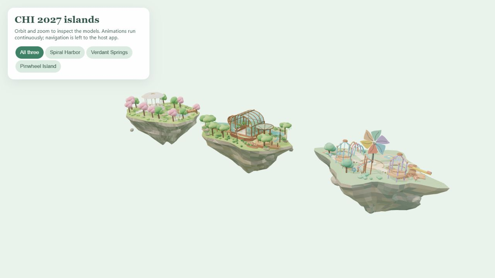

# CHI 2027 island integration kit

Three code-native floating islands prepared for a separate Three.js website. This directory is self-contained except for its npm dependencies. It does not include a player controller or a bridge implementation; those belong to the host experience.



## Contents

| Path | Purpose |
| --- | --- |
| `models/spiral.glb`, `verdant.glb`, `pinwheel.glb` | Static visual snapshots with materials and named walkable meshes |
| `models/*.navigation.json` | Island outline, sampled water mask, hard obstacles, walkable node names, bridge landing points |
| `src/index.js` | Reusable procedural factory, animation updates, and exact navigation queries |
| `src/spiral/`, `src/verdant/`, `src/pinwheel/` | Editable native Three.js geometry and materials |
| `scripts/export-models.mjs` | Regenerates the GLBs and navigation JSON after source changes |
| `demo/` | Orbit-only visual check for all three animated islands |
| `AGENTS.md` | Instructions for an AI agent integrating these islands |

## Use the procedural version

Install dependencies with `npm install`, then import the factory into a Three.js application using the same `three` version. The factory builds the geometry in its own `THREE.Group`. Add that group to your existing scene and call `update` in your render loop:

```js
import {createIsland} from './src/index.js';

const islands = [
  createIsland('spiral', {position: [-17, 0, 0]}),
  createIsland('verdant', {position: [0, 0, 0]}),
  createIsland('pinwheel', {position: [17, 0, 0]})
];
for (const island of islands) scene.add(island.group);

let elapsed = 0;
function frame(deltaSeconds) {
  elapsed += deltaSeconds;
  for (const island of islands) island.update(deltaSeconds, elapsed);
  renderer.render(scene, camera);
}
```

The animation hook keeps Spiral Harbor's boat afloat, Verdant Springs' waterwheel and wind mechanisms turning, and Pinwheel Island's pinwheel, balance beam, and three marbles moving. It does not install its own event listeners, camera, renderer, or navigation controls.

## Navigation and collision data

All coordinates are in each island's local `X/Z` plane; `Y` is up. `createIsland` accepts uniform `scale`, `rotationY`, and `position`. The methods and `walkables` handle those transforms.

```js
const info = island.query(localX, localZ, {radius: 0.22});
// {height, normal, slopeDegrees, surfaceType, walkable, blockedBy, x, z}

const worldInfo = island.queryWorld(playerPosition, {radius: 0.22});
// Adds worldPosition: [x, groundY, z]

const anchors = island.bridgeLandings();
// Each has local/world coordinates, an outward vector, and usable width.
```

`query` samples the highest tagged walkable mesh under the point. `surfaceType` identifies `terrain`, `ramp`, `stair`, `raised_walkway`, `deck`, `terrace`, `path`, `plaza`, or a landing according to the island. `slopeDegrees` is the hit surface's geometric slope. `walkable` and `blockedBy` use the island outline, water, tree trunks, the central Pinwheel mast, and Verdant greenhouse walls. `radius` is the character's horizontal clearance radius. Small plants and decorative shapes remain nonblocking. The host decides its maximum slope, maximum step height, jump rules, and movement speed.

`walkables` is the list of exact mesh surfaces for raycasts or navmesh construction. Every one has a `name` beginning with `NAV_` and a `userData.navSurface` value. In a loaded GLB, look up these names or read `walkableNodes` in the adjacent JSON. Do not treat the entire visual mesh, including the floating geology, as walkable.

The JSON `boundaryXZ` is a polygon around the island top. `waterMask.rows` is a sampled `0`/`1` grid using `originXZ`, `cellSize`, `width`, and `depth`; row 0 is the minimum Z side. It is useful for engines that cannot run the source. The exact procedural `query` and water tests should take priority where available. Bridge landings are connection candidates; verify the final bridge span and clearance against the host world's placement.

## Use the GLBs

Load `models/<island>.glb` with `GLTFLoader`, and read `models/<island>.navigation.json` for placement and collision hints. The GLBs are static snapshots: JavaScript animation and collision logic do not survive GLB export. Use the procedural factory for full fidelity, or reimplement the motions in the host app. The GLBs contain no Blender assets.

## Regenerate and inspect

```bash
npm install
npm run export:models
npm run dev
```

The demo runs at `http://127.0.0.1:5180/`. It provides orbit viewing and continuous animation, with no player movement. Geometry edits belong in the corresponding `src/<island>/` directory. Regenerate the GLBs and JSON after edits. The original three source apps are unchanged by this kit.

## Practical limits

These islands were authored as stylized scenes. The supplied collision regions cover the ground, main routes, water, trees, mast, and greenhouse walls. Decorative rails, narrow posts, and kinetic mechanisms are visible meshes but are not individually included in the simple blocked-area query. If the host uses rigid-body physics, create suitable colliders for those objects and keep the player outside rotating mechanisms. The manifest is an integration aid, not a complete baked navmesh or a guarantee that arbitrary bridge arrangements are traversable.
